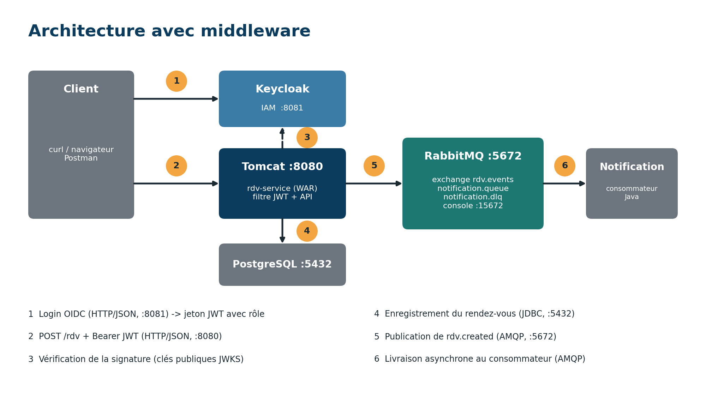

# Projet Middleware – Groupe 2 : plateforme hospitalière de rendez-vous

**Membres :** Guede Ange, Dianka Maxwel, Goho Fealloh Johann

Une plateforme d'hôpital où un **patient** prend rendez-vous, un **médecin** consulte son agenda et un **agent d'accueil** gère l'ensemble. Le projet sert à **rendre trois middlewares observables** :

| Middleware | Famille | Rôle dans le projet | Port(s) |
|---|---|---|---|
| **Apache Tomcat 10.1** | Middleware web | Reçoit les requêtes HTTP et fait vivre l'application Java `rdv-service` | 8080 |
| **Keycloak 26.8** | IAM | Authentifie (jeton JWT) et contrôle l'accès par rôle `patient` / `medecin` / `agent` | 8081 |
| **RabbitMQ 3.13** | MOM (AMQP) | File d'attente asynchrone entre Rendez-vous et Notification | 5672 (AMQP), 15672 (console) |

Autres composants : **PostgreSQL 16** (base des rendez-vous, port 5432) et le service Java autonome **notification-consumer**.

## Architecture



Avant middleware (couplage direct) : `docs/architecture-avant.png`.

Flux : le client obtient un jeton auprès de Keycloak → il appelle `POST /rdv` sur Tomcat avec ce jeton → le filtre vérifie le jeton et le rôle → le rendez-vous est enregistré dans PostgreSQL → un message `rdv.created` est publié dans RabbitMQ → le consommateur Notification le traite quand il est disponible.

## Structure du dépôt

```
projet-middleware-g2/
├── README.md
├── rdv-service/               Service Rendez-vous (Maven, WAR déployé sur Tomcat)
├── notification-consumer/     Consommateur RabbitMQ (Maven, JAR autonome)
├── rabbitmq/definitions.json  Exchange, files et binding (import dans la console)
├── keycloak/realm-hopital.json Realm, rôles, client et utilisateurs (import optionnel)
├── scripts/                   start-all.bat, stop-all.bat, functions.ps1, demo-panne.ps1
├── docs/                      schémas d'architecture et captures d'écran (docs/captures)
└── rapport/                   rapport Word et présentation PowerPoint
```

## Identifiants de démonstration (à ne jamais utiliser en production)

| Service | Identifiant | Mot de passe |
|---|---|---|
| Console RabbitMQ (http://localhost:15672) | `admin` | `admin123` |
| Console Keycloak (http://localhost:8081) | `admin` | `admin123` |
| PostgreSQL (base `hopital`) | `hopital` | `hopital123` |
| Patient (realm `hopital`) | `patient1` | `patient123` |
| Médecin | `medecin1` | `medecin123` |
| Agent d'accueil | `agent1` | `agent123` |

---

# A. REDÉMARRER LE PROJET APRÈS AVOIR ÉTEINT L'ORDINATEUR (le plus courant)

Les conteneurs existent déjà : il suffit de les relancer. Rien n'est à reconfigurer.

1. Ouvrir **Docker Desktop** et attendre **Engine running** (en bas à gauche).
2. Ouvrir PowerShell dans `C:\projet-middleware-g2` et lancer :

```powershell
scripts\start-all.bat
```

Ce script démarre `postgres`, `rabbitmq`, `keycloak`, attend 40 secondes, puis démarre `tomcat-rdv` et `notification-consumer`.

3. Vérifier :

```powershell
docker ps
curl.exe -s http://localhost:8080/health
```

`docker ps` doit montrer **5 conteneurs en Up**. `/health` doit répondre `"status":"UP"`.

Pour tout arrêter proprement : `scripts\stop-all.bat`.

> Si un conteneur n'apparaît pas dans `docker ps -a`, il a été supprimé : suivre la partie B.

---

# B. PREMIÈRE INSTALLATION (ordinateur vierge, Windows 11)

## B.1 Outils

| Outil | Version utilisée | Téléchargement |
|---|---|---|
| WSL 2 | – | PowerShell administrateur : `wsl --install`, puis redémarrer |
| Docker Desktop | 29.8 | https://www.docker.com/products/docker-desktop/ (option WSL 2 cochée) |
| JDK Temurin | **17** | https://adoptium.net/temurin/releases/?version=17 (cocher *Add to PATH* et *Set JAVA_HOME*) |
| Maven | 3.10 | https://maven.apache.org/download.cgi (zip dans `C:\maven`, ajouter `C:\maven\apache-maven-3.10.0\bin` au PATH) |
| Git | 2.56 | https://git-scm.com/downloads |
| VS Code (optionnel) | – | https://code.visualstudio.com/ |

Vérification dans un **nouveau** PowerShell :

```powershell
docker run hello-world
java -version      # doit indiquer 17
mvn -version       # doit indiquer Java 17
git --version
```

Si plusieurs JDK sont installés, `JAVA_HOME` et le `PATH` doivent pointer sur le **JDK 17**.

## B.2 Dossier du projet

```powershell
mkdir C:\projet-middleware-g2
cd C:\projet-middleware-g2
git init
```

Copier dans ce dossier le contenu de ce dépôt (`rdv-service`, `notification-consumer`, `rabbitmq`, `keycloak`, `scripts`, `docs`).

## B.3 Lancer les trois conteneurs d'infrastructure

```powershell
docker run -d --name rabbitmq -p 5672:5672 -p 15672:15672 -e RABBITMQ_DEFAULT_USER=admin -e RABBITMQ_DEFAULT_PASS=admin123 rabbitmq:3-management

docker run -d --name keycloak -p 8081:8080 -e KC_BOOTSTRAP_ADMIN_USERNAME=admin -e KC_BOOTSTRAP_ADMIN_PASSWORD=admin123 quay.io/keycloak/keycloak:latest start-dev

docker run -d --name postgres -p 5432:5432 -e POSTGRES_USER=hopital -e POSTGRES_PASSWORD=hopital123 -e POSTGRES_DB=hopital postgres:16
```

Attendre ~40 secondes, puis `docker ps` doit montrer les 3 conteneurs en **Up**.

> Le port **8081** est utilisé pour Keycloak afin de laisser 8080 à Tomcat.

## B.4 Configurer RabbitMQ

**Option 1 – Import (rapide).** Console http://localhost:15672 → onglet **Overview** → **Import definitions** → choisir `rabbitmq/definitions.json` → **Upload broker definitions**.

**Option 2 – À la main.** Console → **Queues and Streams** :
1. Créer la file `notification.dlq` (Classic, Durable).
2. Créer la file `notification.queue` avec deux arguments (type *String*) : `x-dead-letter-exchange` = *(vide)* et `x-dead-letter-routing-key` = `notification.dlq`.
3. Onglet **Exchanges** → créer `rdv.events`, type `topic`, Durable.
4. Ouvrir `rdv.events` → **Bindings** → vers la file `notification.queue`, routing key `rdv.created`.

Vérification : `notification.queue` affiche les badges **D**, **DLX**, **DLK**.

## B.5 Configurer Keycloak

**Option 1 – Import (optionnel, non testé).** Recréer le conteneur Keycloak en important le realm, depuis `C:\projet-middleware-g2` :

```powershell
docker rm -f keycloak
docker run -d --name keycloak -p 8081:8080 -e KC_BOOTSTRAP_ADMIN_USERNAME=admin -e KC_BOOTSTRAP_ADMIN_PASSWORD=admin123 -v "$PWD\keycloak\realm-hopital.json:/opt/keycloak/data/import/realm-hopital.json" quay.io/keycloak/keycloak:latest start-dev --import-realm
```

**Option 2 – À la main (méthode de référence)**, console http://localhost:8081 :

1. **Manage realms → Create realm** : nom `hopital`. Vérifier que le realm affiché est bien `hopital`.
2. **Realm roles → Create role** : `patient`, `medecin`, `agent`.
3. **Clients → Create client** : type *OpenID Connect*, Client ID `rdv-app`, **Client authentication = Off**, cocher **Direct access grants**, Valid redirect URIs `http://localhost:8080/*`.
4. **Users → Add user**, pour chacun des 3 utilisateurs :

| Username | Email | Prénom | Nom | Mot de passe | Rôle |
|---|---|---|---|---|---|
| `patient1` | `patient1@hopital.ci` | Awa | Kone | `patient123` | `patient` |
| `medecin1` | `medecin1@hopital.ci` | Koffi | Yao | `medecin123` | `medecin` |
| `agent1` | `agent1@hopital.ci` | Mariam | Traore | `agent123` | `agent` |

Pour chaque utilisateur : *Email verified* = On → **Create** ; onglet **Credentials** → **Set password** (*Temporary* = Off) ; onglet **Role mapping** → **Assign role** (filtre *Filter by realm roles*).

Test du jeton :

```powershell
curl.exe -s -X POST "http://localhost:8081/realms/hopital/protocol/openid-connect/token" -d "client_id=rdv-app" -d "grant_type=password" -d "username=patient1" -d "password=patient123"
```

La réponse contient un `access_token` (à décoder sur https://jwt.io : `preferred_username` et `realm_access.roles`). Il expire au bout de **5 minutes**.

> Erreur `Account is not fully set up` : prénom, nom ou email manquant sur l'utilisateur.

## B.6 Compiler et lancer le service Rendez-vous (Tomcat)

```powershell
cd C:\projet-middleware-g2\rdv-service
mvn clean package
docker build -t rdv-service .
docker run -d --name tomcat-rdv -p 8080:8080 rdv-service
docker logs tomcat-rdv --tail 30
```

Les logs doivent contenir `[TOMCAT] Application rdv-service DEMARREE` et `[BASE] PostgreSQL prête`. Test : `curl.exe -s http://localhost:8080/health`.

## B.7 Compiler et lancer le consommateur Notification

```powershell
cd C:\projet-middleware-g2\notification-consumer
mvn clean package
docker build -t notification-consumer .
docker run -d --name notification-consumer notification-consumer
docker logs notification-consumer --tail 10
```

Log attendu : `[RABBITMQ] connecté ... en attente de messages sur 'notification.queue'`.

> Après toute modification du code : refaire `mvn clean package`, puis `docker rm -f tomcat-rdv` (ou `notification-consumer`), `docker build ...` et `docker run ...`.

---

# C. UTILISATION ET TESTS

Dans PowerShell, depuis `C:\projet-middleware-g2` :

```powershell
Set-ExecutionPolicy -Scope Process -ExecutionPolicy Bypass
. .\scripts\functions.ps1
$t = Get-Token patient1 patient123
```

(Le jeton expire après 5 minutes : refaire `$t = Get-Token ...` en cas de **401**.)

## API

| Méthode et URL | Rôle exigé | Description |
|---|---|---|
| `GET /health` | aucun | Statut, thread Tomcat, session |
| `POST /rdv` | `patient` | Prendre un rendez-vous (`{"motif":"...","date":"2026-10-12T09:00"}`) |
| `GET /rdv/mes-rdv` | `patient` | Ses rendez-vous |
| `GET /rdv/agenda` | `medecin` | Agenda |
| `PUT /rdv/{id}/valider` | `medecin` | Valider un rendez-vous |
| `GET /rdv` | `agent` | Tous les rendez-vous |
| `DELETE /rdv/{id}` | `agent` | Supprimer |

## Tests de sécurité (Keycloak)

```powershell
curl.exe -i http://localhost:8080/rdv                                         # 401 : pas de jeton
New-Rdv $t                                                                     # 201 : patient crée un RDV
curl.exe -i http://localhost:8080/rdv/agenda -H "Authorization: Bearer $t"     # 403 : patient sur l'agenda
$m = Get-Token medecin1 medecin123
curl.exe -i http://localhost:8080/rdv/agenda -H "Authorization: Bearer $m"     # 200 : médecin
```

## Suivre une requête dans les journaux

```powershell
docker logs tomcat-rdv --tail 20
```

Chaque requête laisse : `[AVANT]` (thread Tomcat) → `[KEYCLOAK]` (utilisateur et rôles) → `[BASE]` → `[RABBITMQ]` (message publié) → `[APRES]` (code HTTP).

---

# D. DÉMONSTRATION OBLIGATOIRE : PANNE DU CONSOMMATEUR

Version automatique : `powershell -ExecutionPolicy Bypass -File scripts\demo-panne.ps1`

Version manuelle (console RabbitMQ ouverte sur **Queues and Streams**) :

```powershell
docker stop notification-consumer
1..15 | ForEach-Object { New-Rdv $t }       # 15 réponses 201
# Console : notification.queue -> Ready = 15  (CAPTURE)
docker start notification-consumer
# Console : Ready descend jusqu'à 0 en ~15 s  (CAPTURE)
docker logs notification-consumer | Select-String "NOTIFICATION"
```

**Ce qu'on démontre :** pendant la panne, Rendez-vous continue de fonctionner (réponses 201), les messages attendent dans `notification.queue`, et à la relance les 15 notifications sont traitées une à une, sans perte.

Résultat obtenu lors des essais : 15 rendez-vous (n°3 à n°17) créés en 2 secondes pendant l'arrêt, puis 15 notifications traitées de 00:17:05 à 00:17:20, chacune acquittée (`ack`).

## Pannes complémentaires

**Message illisible → file d'erreurs.** Console → exchange `rdv.events` → *Publish message* : routing key `rdv.created`, payload `ceci n'est pas du json`. Le consommateur affiche `[ERREUR] ... notification.dlq` et `notification.dlq` passe à **Ready = 1**.

**Keycloak arrêté.**
```powershell
$t = Get-Token patient1 patient123
docker stop keycloak
curl.exe -i http://localhost:8080/rdv/mes-rdv -H "Authorization: Bearer $t"   # 200 : jeton déjà émis encore accepté
$t2 = Get-Token patient1 patient123                                             # vide : plus de nouvelle connexion
docker start keycloak
```
Les clés publiques de Keycloak sont mises en cache environ 5 minutes par l'API ; au-delà, l'API répond **503** si Keycloak reste arrêté.

**RabbitMQ arrêté.**
```powershell
docker stop notification-consumer
1..3 | ForEach-Object { New-Rdv $t }
docker stop rabbitmq
New-Rdv $t          # 201 avec "notification":"echec_publication"
docker start rabbitmq
```
Après le redémarrage, `notification.queue` contient toujours les 3 messages (file durable, messages persistants). Limite connue : la notification du rendez-vous créé pendant l'arrêt est perdue (amélioration possible : table *outbox*).

**Tomcat arrêté.** `docker stop tomcat-rdv` : l'API est injoignable, Keycloak et RabbitMQ continuent. `docker start tomcat-rdv` : le log affiche de nouveau `Application rdv-service DEMARREE`.

---

# E. OÙ OBSERVER QUOI

| Middleware | Où regarder | Ce qu'on y voit |
|---|---|---|
| Tomcat | `docker logs tomcat-rdv` ; `GET /health` | Démarrage de l'application, thread `http-nio-8080-exec-N`, session, codes HTTP |
| Keycloak | http://localhost:8081 (realm `hopital`) : *Sessions*, *Users* ; https://jwt.io | Sessions ouvertes, rôles, contenu du jeton, 401/403/200 côté API |
| RabbitMQ | http://localhost:15672 : *Queues and Streams*, *Connections*, *Exchanges* | Ready / Unacked, débits `incoming` / `deliver` / `ack`, connexions, DLQ |
| Base | `docker exec -it postgres psql -U hopital -d hopital -c "SELECT * FROM rendez_vous;"` | Rendez-vous enregistrés |

# F. COMMANDES UTILES

```powershell
docker ps                       # conteneurs actifs
docker ps -a                    # tous les conteneurs (même arrêtés)
docker logs <nom> --tail 30     # derniers logs (tomcat-rdv, notification-consumer, rabbitmq, keycloak)
docker restart <nom>            # redémarrer un conteneur
docker rm -f <nom>              # supprimer un conteneur (puis le recréer avec docker run)
```

# G. DÉPANNAGE

| Symptôme | Cause probable | Solution |
|---|---|---|
| `failed to connect to the docker API` | Docker Desktop non démarré | Lancer Docker Desktop, attendre *Engine running* |
| `mvn` : *no POM in this directory* | Mauvais dossier | `cd C:\projet-middleware-g2\rdv-service` (ou `notification-consumer`) |
| `port is already allocated` | Port déjà utilisé | Arrêter le programme concerné ou changer le port à gauche du `:` |
| 401 alors que le jeton est fourni | Jeton expiré (5 min) | `$t = Get-Token patient1 patient123` |
| `Get-Token` non reconnue | Fonction non chargée | `. .\scripts\functions.ps1` |
| `curl: Failed to open rdv1.json` | Fichier dans un autre dossier | Utiliser `New-Rdv $t` ou un chemin complet |
| Logs Tomcat : `[BASE] indisponible` | PostgreSQL arrêté | `docker start postgres` puis `docker restart tomcat-rdv` |
| Consommateur : `RabbitMQ indisponible` | RabbitMQ arrêté | `docker start rabbitmq` : reconnexion automatique toutes les 5 s |
| Réponse 503 « Keycloak injoignable » | Keycloak arrêté et clés expirées du cache | `docker start keycloak` (attendre ~40 s) |
| Java 25 au lieu de 17 | PATH sur le mauvais JDK | Mettre le JDK 17 en premier dans `Path` et vérifier `JAVA_HOME` |

# H. SANS MIDDLEWARE : CE QUI CHANGERAIT

- **Sans RabbitMQ** : appel HTTP direct de Rendez-vous vers Notification ; si Notification est arrêtée, la création échoue ou la notification est perdue (couplage fort, aucune reprise).
- **Sans Keycloak** : mots de passe, rôles et sécurité à recoder dans chaque service, sans gestion centralisée ni standard OpenID Connect.
- **Sans Tomcat** : serveur HTTP, threads, sessions et déploiement à écrire soi-même.

# I. AMÉLIORATIONS POSSIBLES

Table *outbox* pour ne perdre aucune notification si RabbitMQ est arrêté ; pool de connexions JDBC ; HTTPS et mode `start` de Keycloak ; secrets hors du code ; `docker-compose.yml` unique ; supervision de la DLQ.
